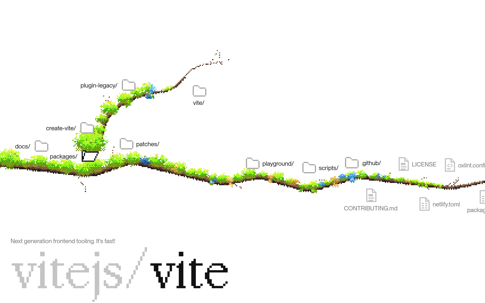

# grow-your-repo

Paste a public GitHub repo's link and its file tree grows as a dithered plant. It's the plant from my portfolio, [garden](https://github.com/nadidazwad/garden), let loose on any repo. The trunk grows in from the left with the top level along it, a folder grows a branch of its own when you open it, and a file opens on GitHub.



## How it works

- **Fetching** happens in your browser, straight from GitHub, with no server and no token. A repo costs two of the 60 requests an hour GitHub gives each visitor: one for its default branch, one for its whole tree at once. A missing or private repo, an unknown branch, an empty repo, a spent hour and a tree too big to send whole each get a plain line saying so.
- **Placing** is the real work. In my portfolio I placed every point of the plant by hand. Here `src/place/` has to do it for any tree. Each folder's branch is a seeded walk out of the folder: it runs out along a corridor kept clear for it, then sways between climbing and running on, the way the hand-drawn branches do. It steers round the names already there, and when it's caught in a crowd it takes the clearest way out to open sky. Files and folders hang along it, mostly with their names to the right. The same repo always grows the same plant.
- **One chain at a time.** Opening a folder closes its open siblings, so a branch only keeps clear of the folders it grows out of, and siblings share the same sky. It also means a folder is only placed when it first opens, so a repo with tens of thousands of files costs only what you explore.
- **Big folders** carry fifteen entries a branch. The rest wait on a "+ 1,240 more" node at the tip, which grows the next fifteen when you open it.
- **The address** is the repo and wherever you are in it, like `/vitejs/vite/packages/vite`. A link grows straight down to that folder, and Back walks the plant back.
- **The name on the ground** is also where the next repo goes: click it, type or paste over it, and a new plant grows.
- **The phone** gets a plant of its own, a vine climbing a narrow column, with the name stacked on the ground. Its branches sweep from wall to wall, the way I drew them by hand for the portfolio. Opening a folder there draws the branch it hangs on back to it: what hangs further along folds away, and the vine climbs on from the open folder into the sky they leave. Step back out and they grow back.
- **The plant itself**, the dither, the icons and the sound all come from garden; its README says how they're made. The file glyphs for code and data are new, drawn on the same pixel grid.

I build with AI agents. The taste, the direction and the final call are mine.

## Running it

```sh
pnpm install
pnpm dev      # http://localhost:5173
pnpm build    # fonts, typecheck, production build to dist/
pnpm test
```

In dev, `/__overview?repo=facebook/react&open=packages` draws a saved repo's open chain as lines, with any name crowded by a branch in red, and `/__grown?repo=facebook/react` grows it as the real plant. Add `&shape=tall` for the phone's. Neither asks GitHub.

The fonts (PP Neue Montreal, PP Mondwest and PP NeueBit, from Pangram Pangram) are licensed to my site, not to everyone who clones it, so they aren't here. Put your own copies in `public/fonts/`, or it runs on system fonts. My deploys pull them from a private repo.

## Licence

MIT, so take whatever's useful.
